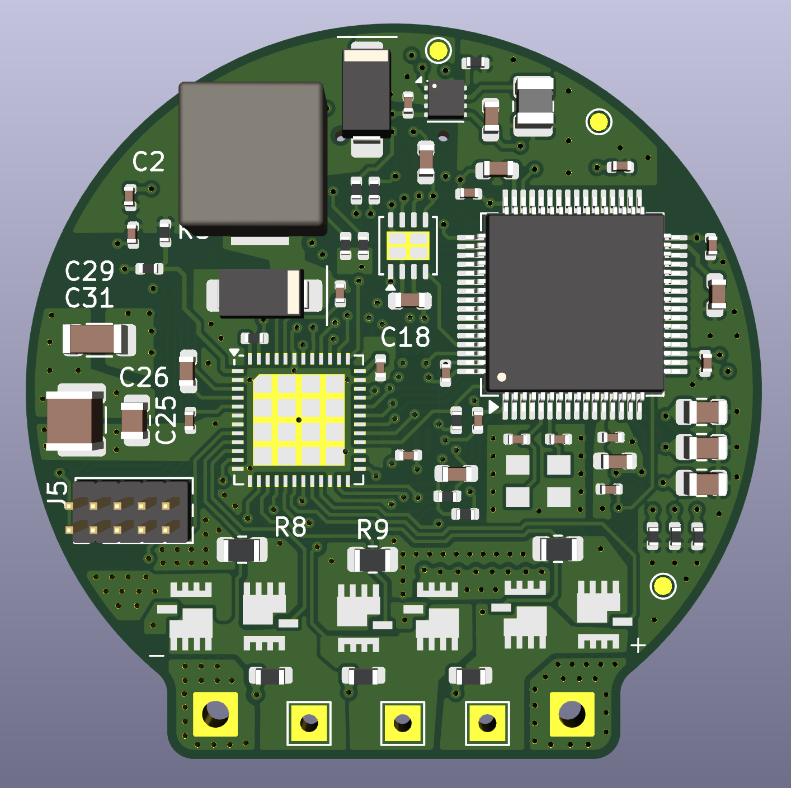
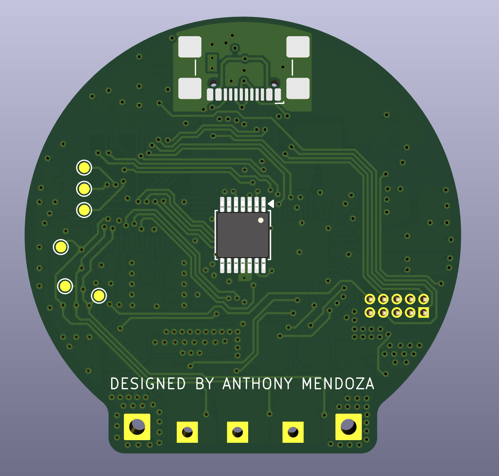

# FOC BLDC Servo Motor Controller

This board is a three phase field oriented control (FOC) motor controller for a brushless DC (BLDC) servo motor with an encoder. It combines a 32 bit microcontroller, a three-phase gate driver, six external power MOSFETs, phase current sensing, bus voltage sensing, motor temperature sensing, and encoder feedback.




## Functional overview

| Function | Main parts / nets | Purpose |
|---|---|---|
| MCU and control | STM32F405RGTx (U2) | Runs FOC, PWM generation, feedback processing, communications, and protection logic |
| Three-phase gate drive | DRV8323RSRGZT (U1) | Converts MCU PWM commands into high- and low-side MOSFET gate drive |
| Power stage | Q1-Q6, IQE022N06LM5CG | Six-switch inverter producing phase_A, phase_B, and phase_C |
| Current measurement | R8-R10, 1 mOhm | Low-side shunt current sensing for phases A, B, and C |
| Rotor position | AS5147U (shown on the drive sheet) | Magnetic encoder read over SPI; provides rotor angle feedback |
| DC-bus measurement | R11/R12, R14/R18, R16/R17 | Scales phase/bus-related sense nodes into MCU ADC inputs |
| Temperature measurement | R3 NTC 10k, R2 10k, C33 | Motor/board temperature input on `TEMP_MOTOR` / `ADC_TEMP` |
| Logic power | TPS62162DSG (U3) | Converts `+5V` to regulated `+3.3V` |
| CAN | TJA1051TK-3 (U4) | 3.3 V MCU CAN interface to `CANH` and `CANL` |
| USB | J4 USB-C | USB 2.0 device connection to the MCU; CC pull-downs are fitted |

## External connections

### DC bus:

| P1 pin | Schematic net | Description |
|---:|---|---|
| 1 | `GND` / `-Bat` | DC-bus negative |
| 2 | `+BATT` / `+Bat` | DC-bus positive |

`+BATT` feeds the DRV8323 power stage and the high-side MOSFET drains. `GND` is the power-stage return. Confirm the current board's polarity and connector orientation before connection.

### Encoder: AS5147U

| Encoder signal | Schematic net |
|---|---|
| VDD / VDD3V3 | `+3.3V` |
| Ground | `GND` |
| MOSI | `SPI3_MOSI` / `MOSI` |
| MISO | `SPI3_MISO` / `MISO` |
| CLK | `SPI3_SCK` / `CLK` |
| CSn | `SPI3_CS` / `CSn` |

## Control, debug, and communications

### SWD / service header

| Signal | Schematic label |
|---|---|
| CAN bus | `CAN_L`, `CAN_H` |
| Logic supply | `+3.3V` |
| Debug reset | `NRST` |
| Debug clock | `SWCLK` |
| Debug data | `SWDIO` |
| Return | `GND` |


### USB-C: J4

J4 is a USB 2.0 USB-C receptacle. The schematic connects:

- `D+` to MCU `USB_DP` through R4, 22 ohm.
- `D-` to MCU `USB_DM` through R21, 22 ohm.
- `CC1` and `CC2` to ground through R19 and R20, 5.1 kOhm.
- VBUS to `+5V`.
- Shield and USB ground to `GND` as shown.

USB is intended for MCU communication, programming, or diagnostics. It is not the motor-power input.

### CAN

U4, the TJA1051TK-3, translates MCU CAN signals to the differential bus:

- MCU `CAN_TX` -> U4 TXD
- MCU `CAN_RX` -> U4 RXD
- U4 `CANH` -> external `CANH`
- U4 `CANL` -> external `CANL`
- U4 VCC -> `+5V`
- U4 VIO -> `+3.3V`


## Internal signal map

| MCU function | Net(s) |
|---|---|
| Phase PWM control | `HA`, `HB`, `HC`, `LA`, `LB`, `LC` |
| Gate-driver enable | `EN_GATE` |
| Gate-driver fault | `FAULT` |
| Phase current ADCs | `CURRENT_A`, `CURRENT_B`, `CURRENT_C` |
| Temperature ADC | `TEMP_MOTOR` / `ADC_TEMP` |
| Phase/bus voltage ADCs | `VOLTAGE_A`, `VOLTAGE_B`, `VOLTAGE_C` |
| Encoder SPI | `SPI3_CS`, `SPI3_SCK`, `SPI3_MISO`, `SPI3_MOSI` |
| CAN | `CAN_TX`, `CAN_RX` |
| Servo input | `SERVO` |


## Power tree


```text
USB VBUS (+5V) -> TPS62162DSG -> +3.3V logic rail
DC bus (+BATT) -> DRV8323 VM and MOSFET bridge
DC bus return   -> GND / power-stage return
```

The logic rail has local decoupling at the MCU, encoder, gate driver, and regulator.

## Current and voltage sensing

- R8, R9, and R10 are shown as 1 mOhm low-side shunts for phases A, B, and C.
- The DRV8323 sense inputs are labelled `SOA`, `SOB`, and `SOC`.
- The MCU receives `CURRENT_A`, `CURRENT_B`, and `CURRENT_C`.
- Phase-voltage divider channels use 39 kOhm high-side resistors and 2.2 kOhm low-side resistors, with 1 uF filtering capacitors on the sense nodes.

## Configuration
```cpp
//Vesc pin definition for SPI control over DRV8323
#define DRV8323S_MOSI_GPIO      GPIOC
#define DRV8323S_MOSI_PIN       53      //PC12
#define DRV8323S_MISO_GPIO      GPIOC
#define DRV8323S_MISO_PIN       52      //PC11
#define DRV8323S_SCK_GPIO       GPIOC
#define DRV8323S_SCK_PIN        51      //PC10
#define DRV8323S_CS_GPIO        GPIOC
#define DRV8323S_CS_PIN         50      //PA15
```

```cpp
//Encoder definition for AS5x47u over SPI
#define HW_SPI_DEV              SPID1
#define HW_SPI_GPIO_AF          GPIO_AF_SPI1

#define HW_SPI_PORT_NSS         GPIOA   // AS5x47U CS
#define HW_SPI_PIN_NSS          4       // PA4

#define HW_SPI_PORT_SCK         GPIOA   // SCLK
#define HW_SPI_PIN_SCK          5       // PA5

#define HW_SPI_PORT_MOSI        GPIOA   // MOSI / SDI
#define HW_SPI_PIN_MOSI         7       // PA7

#define HW_SPI_PORT_MISO        GPIOA   // MISO / SDO
#define HW_SPI_PIN_MISO         6    

AS5x47U_config_t encoder_cfg_as5x47u = {
#ifdef HW_SPI_DEV
        &HW_SPI_DEV,

        {
                enc_as5x47u_spi_callback,
                HW_SPI_PORT_NSS,
                HW_SPI_PIN_NSS,
                SPI_BaudRatePrescaler_8 |
                SPI_CR1_CPHA |
                SPI_DATASIZE_8BIT
        },

        HW_SPI_GPIO_AF,
        HW_SPI_PORT_NSS,  HW_SPI_PIN_NSS,
        HW_SPI_PORT_SCK,  HW_SPI_PIN_SCK,
        HW_SPI_PORT_MOSI, HW_SPI_PIN_MOSI,
        HW_SPI_PORT_MISO, HW_SPI_PIN_MISO,
#endif
};
```
